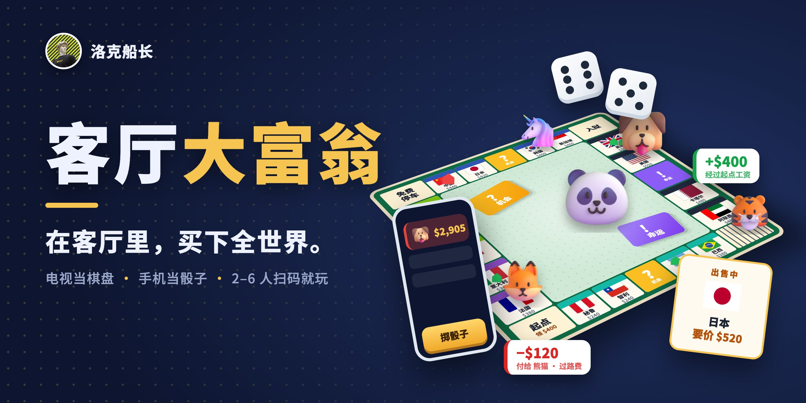
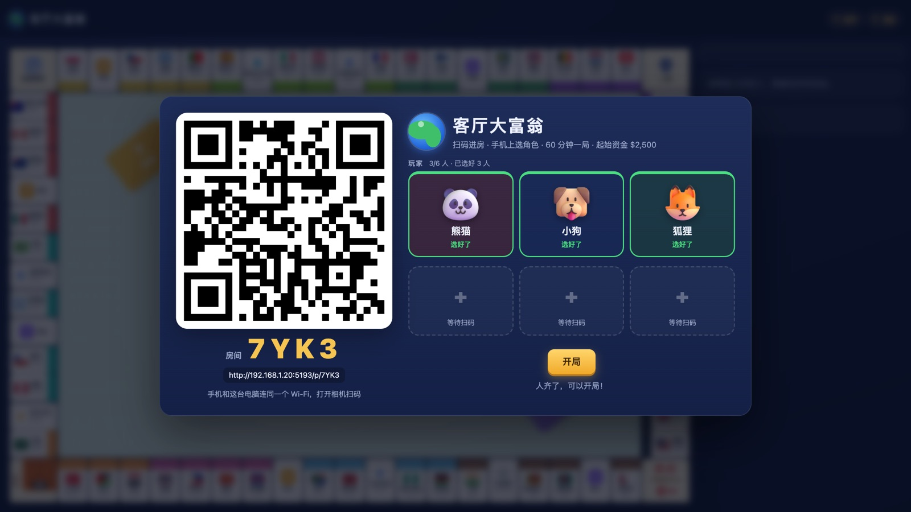
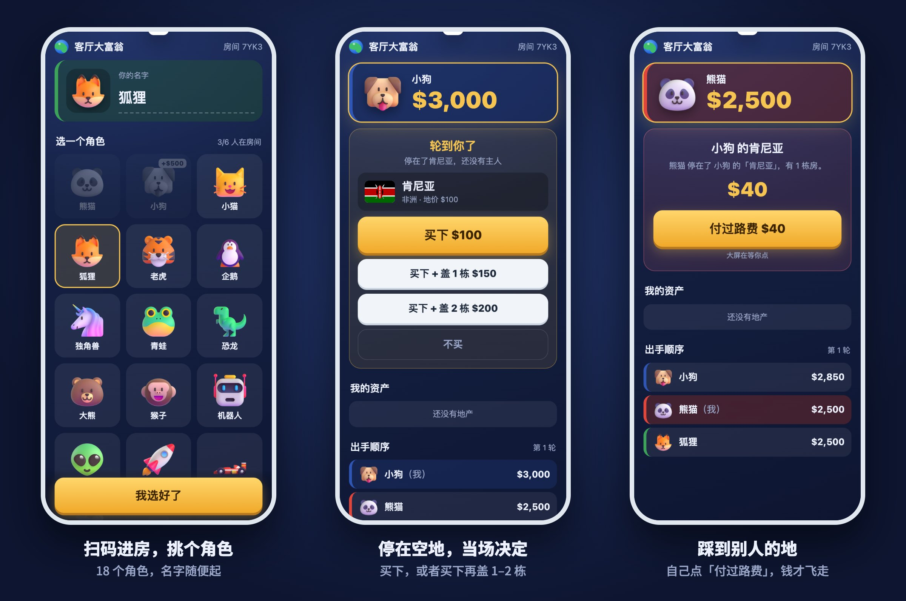
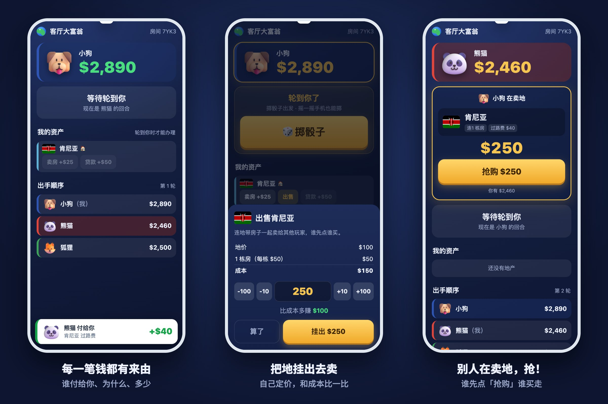
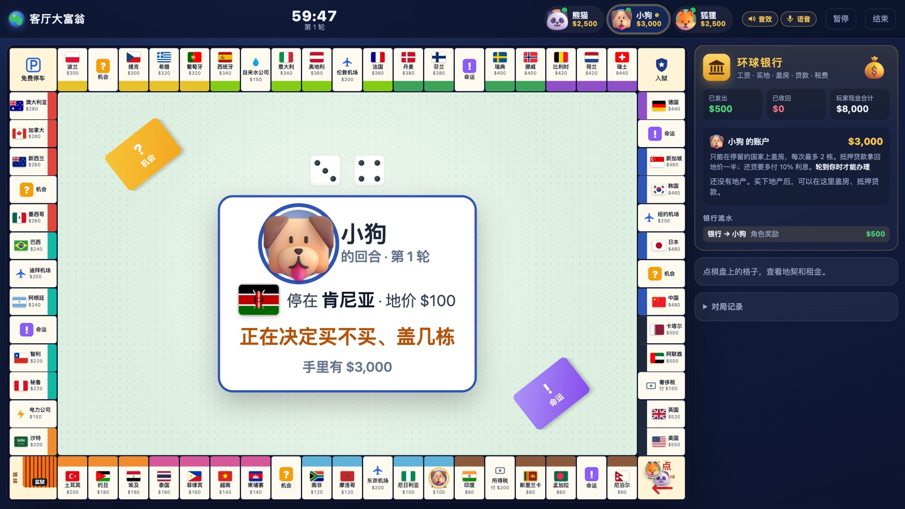
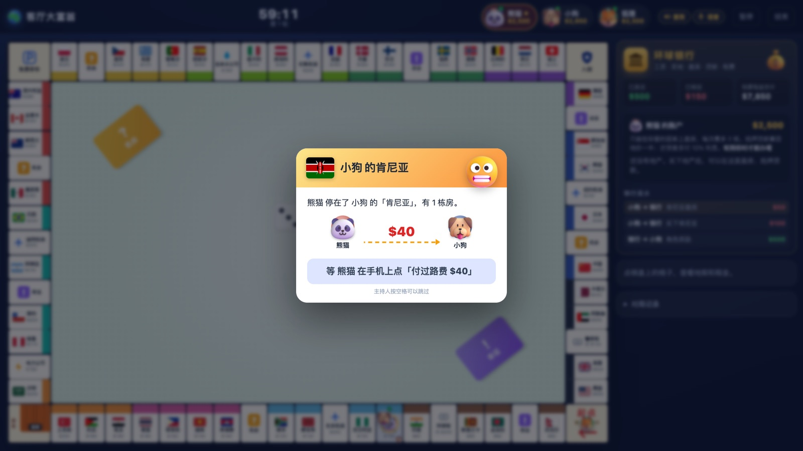
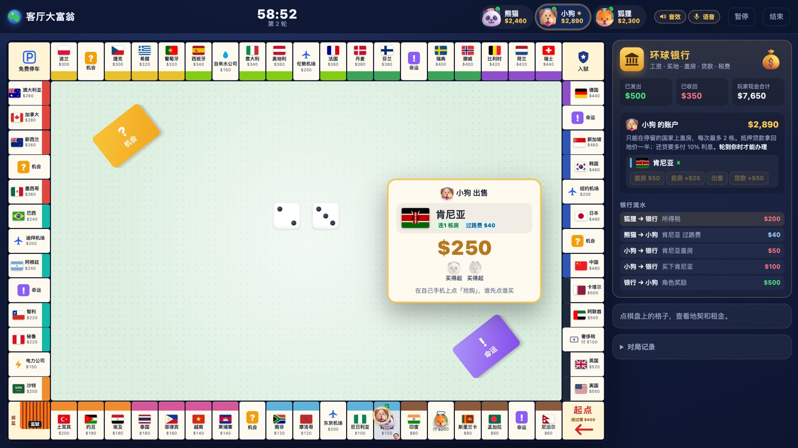

<p align="center"></p>

<h1 align="center">客厅大富翁</h1>
<p align="center"><b>在客厅里，买下全世界。</b><br>电视当棋盘，手机当骰子。2–6 个人，扫个码就开局。</p>

---

## 今晚怎么玩

1. **电脑接上电视**，打开大屏页面，屏幕上会出现一个二维码。
2. **大家掏出手机扫码**，起个名字，从熊猫、小狗、狐狸、独角兽……18 个角色里挑一个。不用下载 App，也不用注册。
3. **主持人点「开局」**，电视倒数 3、2、1，60 分钟一局，开始抢地盘。

<p align="center"><br><sub>电视上的房间：扫码进来的人一个个出现在右边，选好角色就亮绿框</sub></p>

## 你手里的手机能做什么

<p align="center"></p>
<p align="center"></p>

- **掷骰子**：点按钮，或者直接摇一摇手机。
- **买地盖房**：停在没主人的国家，手机上直接选「买下」还是「买下 + 盖 2 栋」。
- **看自己的钱包**：谁付给你过路费、你在哪交了税，每一笔都会弹一张小卡，告诉你是谁、为什么、多少钱，钱数跟着滚上去或掉下来。
- **把地挂出去卖**：自己定价，所有人的手机都会收到，谁先点「抢购」谁买走。
- **轮到你时手机会震**：再也不用大家盯着你喊「到你了！」
- **不小心退出了也没事**：大屏上点一下你的头像，扫码就回到原来的座位，钱和地都还在。

## 电视上能看到什么

<p align="center"><br><sub>轮到谁、停在哪、在手机上犹豫什么，坐在沙发另一头也看得清</sub></p>

<table><tr>
<td width="50%"><br><sub>踩到别人的地：等当事人在手机上点「付过路费」</sub></td>
<td width="50%"><br><sub>有人卖地：出售卡挂在棋盘上，大家拿手机抢</sub></td>
</tr></table>

- 骰子在棋盘中间滚，棋子一格一格往前跳，买地时盖章，盖房时房子冒出来。
- 中间一张大卡片，写着现在轮到谁、停在哪个国家、在手机上犹豫什么。谁忘了操作，全屋都看得见。
- 踩到别人的地、抽到机会卡、被关进监狱，都有弹框、音效和语音播报。
- 只剩「结束回合」可点时，倒数 3 秒自动轮到下一位，节奏不会断。

## 规则一分钟

- 每人起始资金 **$2,500**，经过起点领 **$400** 工资。
- 棋盘一圈 **68 格**，有 **48 个国家**，按大洲分成 12 组，越往后越贵，美国最贵。
- 停在没人买的国家可以买下，**当场最多盖 2 栋房子**；以后每次停在自己的国家上，还能再加盖。盖满 4 栋可以升级成酒店。
- 停在别人的地上要交过路费，房子越多越贵。
- 机会、命运卡可能发钱，也可能让你进监狱。出狱要交 $50、用出狱卡，或者掷出双数。
- 没钱了可以卖房、把地抵押给银行贷款，还不上就破产出局。
- **最后只剩一个人**，或者 60 分钟到了按总资产排名，第一名就是**客厅首富**。

详细规则见 [规则.md](规则.md)。

## 自己架一台

需要一台装了 [Node.js](https://nodejs.org)（18 以上）的电脑：

```bash
git clone https://github.com/bassnova42/party-tycoon.git
cd party-tycoon
npm install
npm start
```

终端里会打印两个地址：

- **大屏**：`http://localhost:5200/party`，在这台电脑上打开，投到电视上。
- **手机**：扫大屏上的二维码就行。手机要和电脑连**同一个 Wi-Fi**。

> 第一次启动时，Mac 可能会问「是否允许 node 接收网络连接」，点允许，否则手机连不上。

想要更好听的语音播报，可以在项目目录建一个 `.env` 文件，写上 `GEMINI_API_KEY=你的密钥`，就会用 Gemini 的配音；不填就用浏览器自带的声音。

另外还有两种玩法：

- `http://localhost:5200/`：一台电脑轮流点，适合两个人凑一起玩。
- `http://localhost:5200/online`：早期的在线大厅版本。

## 给开发者

- 规则引擎在 [shared/engine.js](shared/engine.js)，服务器和浏览器共用，服务器说了算。
- 聚会模式的房间在 [party.js](party.js)；大屏是 [public/play.js](public/play.js)，手机是 [public/phone.js](public/phone.js)。
- [技术方案.md](技术方案.md) 写了结构和消息协议；[passes/](passes/) 是每一轮开发的说明。
- 测试：`node test/sim.mjs`（300 局机器人对局）、`node test/party.mjs`（聚会模式全流程）。

## 素材

- 角色：[Microsoft Fluent Emoji](https://github.com/microsoft/fluentui-emoji)（MIT）
- 国旗：[flag-icons](https://github.com/lipis/flag-icons)（MIT）
- 二维码：[qrcode-generator](https://github.com/kazuhikoarase/qrcode-generator)（MIT）

---

<p align="center">洛克船长 做的 · <a href="https://x.com/slashui">X @slashui</a></p>
